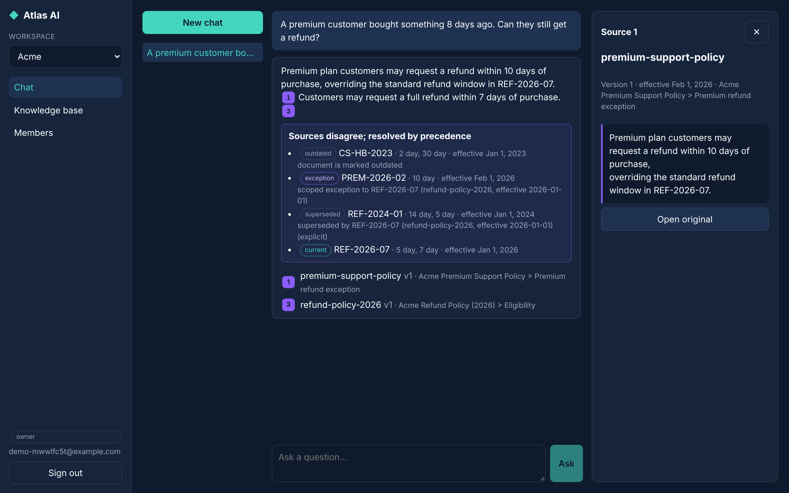

# Atlas AI

Multi-tenant agentic RAG SaaS. Companies sign up, create an organization,
invite members, upload documents (PDF, DOCX, TXT, MD) and ask questions.
Answers cite their sources, flag conflicting policy versions, and say so when
the evidence isn't there. Each organization's data is isolated by Postgres
row-level security, not just application code.

**Live demo:** not deployed yet. The frontend is on Vercel
(https://atlas-ai-lake-sigma.vercel.app) but is not connected to a hosted backend
until the Cloud Run deployment in [docs/deployment.md](docs/deployment.md) is done.



## What it does

- **Workspaces and roles**: organizations, invitations, owner/admin/member/viewer,
  per-document ACLs; Supabase Auth.
- **Knowledge base**: uploads with versions, background ingestion (parse, chunk,
  dense + BM25 embeddings), duplicate detection, safe delete, signed downloads.
- **Agentic answers**: a bounded LangGraph agent plans retrieval, rewrites weak
  queries, rechecks every chunk against Postgres permissions, resolves version
  conflicts (explicit supersedes, exceptions, effective dates), verifies
  citations and abstains when evidence is weak.
- **Hardening**: trigger-written audit logs, quotas and rate limits, revocation
  handling, prompt-injection defences, OpenTelemetry tracing, sanitized logs.

## Measured results

Only offline runs exist so far (no model key): hash embeddings, an extractive
generator, an 80-chunk synthetic corpus, 105 hand-labeled questions. They
measure behaviour, not answer quality ([details](docs/evaluation/README.md)):

| | hybrid baseline | full agent |
|---|---|---|
| Cites superseded or outdated sources (conflict questions) | 93.8% | **0%** |
| Abstains when the documents don't contain the answer | 68.8% | **87.5%** |
| Resists injected instructions in documents | 75% | **100%** |
| Fact accuracy (string match) | 78.4% | 79.5% |

Blueprint quality targets (e.g. faithfulness ≥ 90%) are **targets**, not yet
measured with a real model. Security properties are covered by a separate
test suite (cross-tenant access via the API and directly in Postgres, every
endpoint swept, injection, revocation); see [docs/security](docs/security/README.md).

## Documentation

[Architecture](docs/architecture/README.md) ·
[Security model](docs/security/README.md) ·
[API reference](docs/api/README.md) ·
[Evaluation](docs/evaluation/README.md) ·
[Deployment](docs/deployment.md) ·
[Decisions (ADRs)](docs/decisions/README.md)

## Local setup

Requirements: Docker with Compose v2. Python 3.12+ for running tests outside
Docker.

```bash
cp .env.example .env
```

```bash
docker compose up --build
```

Then open **http://localhost:8080**, create an account, create a workspace,
upload a document from `sample-data/acme/` and ask a question.

This starts:

| Service | URL / port | Notes |
|---------|-----------|-------|
| `web` | http://localhost:8080 | React app; proxies `/v1` to the API and `/auth/v1` to Supabase Auth |
| `auth` | localhost:9999 | Supabase Auth (GoTrue); local accounts are auto-confirmed |
| `migrate` | (exits) | Runs migrations, enables the `atlas_api` login, then exits |
| `api` | http://localhost:8000 | FastAPI; docs at `/docs` |
| `worker` | (no port) | Ingestion worker: parse, chunk, embed, index, publish |
| `db` | localhost:54322 | `supabase/postgres` image, user `postgres` |
| `qdrant` | http://localhost:6333 | Dashboard at `/dashboard` |

Check it:

```bash
curl localhost:8000/health
```

```bash
curl localhost:8000/ready
```

`/health` is liveness (process up). `/ready` checks Postgres and Qdrant and
returns `503` with per-check results if either is unreachable.

### Try the API with seed data

Seed the synthetic orgs **Acme** (alice owner, aaron admin, amy member, avery
viewer) and **Nova** (nina owner, noah member):

```bash
docker compose run --rm migrate python -m app.db.manage seed
```

Mint a local token for a seed user (works only with `APP_ENV=local|test` and
the local `SUPABASE_JWT_SECRET`):

```bash
TOKEN=$(docker compose exec -T api python -m app.db.manage dev-token alice@acme.example)
```

```bash
curl -H "Authorization: Bearer $TOKEN" localhost:8000/v1/organizations
```

Endpoints so far:

| Method | Path | Who |
|---|---|---|
| POST, GET | `/v1/organizations` | any signed-in user (GET lists own orgs) |
| GET | `/v1/organizations/{org_id}` | members |
| GET | `/v1/organizations/{org_id}/members` | members |
| POST | `/v1/organizations/{org_id}/members` | owner/admin: invite by email, returns a one-time token |
| PATCH, DELETE | `/v1/organizations/{org_id}/members/{member_id}` | owner/admin: change role, revoke |
| GET | `/v1/organizations/{org_id}/invitations` | owner/admin |
| POST | `/v1/invitations/accept` | the invited user (email must match the JWT) |
| POST, GET | `/v1/organizations/{org_id}/documents` | upload (owner/admin/member; PDF, DOCX, TXT, MD); list visible documents |
| GET, DELETE | `/v1/organizations/{org_id}/documents/{id}` | read with versions; delete (write access, runs as a job) |
| POST | `/v1/organizations/{org_id}/documents/{id}/versions` | upload a new version (write access) |
| POST | `/v1/organizations/{org_id}/documents/{id}/reindex` | reprocess the current version (write access) |
| GET | `/v1/organizations/{org_id}/documents/{id}/versions/{vid}/download-url` | short-lived signed URL (readers) |
| GET | `/v1/organizations/{org_id}/jobs/{id}` | ingestion job status |
| POST | `/v1/organizations/{org_id}/chat` | ask the agent (all roles); SSE (`meta`, `step`, `delta`, `citations`, `done`) with `Accept: text/event-stream`, else JSON with `status`, `evidence_status`, `citations`, `conflicts`, `retrieval_attempts`, `trace_id` |
| GET | `/v1/organizations/{org_id}/conversations[/{id}]` | own conversations, messages and citations |
| GET | `/v1/organizations/{org_id}/usage` | own usage; owners/admins also get org totals and quotas |
| GET | `/v1/organizations/{org_id}/audit-logs` | owners/admins: sensitive actions, newest first |

Errors always look like `{"error": {"code": "...", "message": "...", "request_id": "..."}}`.

Upload a document and watch it get indexed:

```bash
curl -H "Authorization: Bearer $TOKEN" -F file=@sample-data/acme/refund-policy-2026.md \
  localhost:8000/v1/organizations/0a000000-0000-4000-8000-000000000001/documents
```

Ask a question (after the worker has indexed it):

```bash
curl -N -H "Authorization: Bearer $TOKEN" -H "Accept: text/event-stream" \
  -H "Content-Type: application/json" -d '{"question": "How many days do customers have to request a refund?"}' \
  localhost:8000/v1/organizations/0a000000-0000-4000-8000-000000000001/chat
```

Locally `EMBEDDING_PROVIDER=hash` and `LLM_PROVIDER=extractive` run without any
API key: deterministic offline vectors with no semantic quality, and an
extractive generator that quotes matching sentences. Set both to `openai` with
`OPENAI_API_KEY` for real embeddings and answers (then reindex).

## Demo script

Shows Acme vs Nova isolation and the refund-policy conflict answer, against
the local stack or a deployment (see the script header for hosted settings):

```bash
python scripts/demo.py
```

## Evaluation

Benchmarks over 105 labeled questions ([how to run](evaluations/benchmarks/README.md)):
retrieval (dense vs sparse vs hybrid) and a full comparison of five
configurations (dense, hybrid, hybrid+rerank, +rewrite, full agent) for fact
accuracy, abstention, citation correctness, faithfulness, stale citations,
injection resistance, latency and cost. The reports so far
([index](evaluations/reports/README.md)) were run **offline** (hash embeddings, an
extractive generator, an 80-chunk corpus): they check behaviour such as stale
citations and injection handling, not answer quality. Blueprint targets (e.g.
Recall@5 ≥ 85%, faithfulness ≥ 90%) are targets, not results.

Security tests are a separate suite (`backend/tests/security`): tenant isolation
via the API and directly in Postgres, a sweep of every endpoint, prompt
injection, revocation, audit logs and limits.

How isolation works and what is tested: [docs/security/tenant-isolation.md](docs/security/tenant-isolation.md).

Stop and remove data:

```bash
docker compose down --volumes
```

## Development

```bash
cd backend && python -m venv .venv && . .venv/bin/activate && pip install -e '.[dev]'
```

```bash
ruff check . && ruff format --check .
```

Security, ingestion and migration tests need Postgres and Qdrant (they create
and migrate a throwaway `atlas_test` database and a test collection):

```bash
docker compose up -d db qdrant
```

```bash
pytest -m "not integration"
```

Integration tests run against the full, seeded compose stack:

```bash
ATLAS_REQUIRE_STACK=1 pytest -m integration
```

New migration (plain SQL in `op.execute`, see `backend/migrations/versions`):

```bash
alembic revision -m "describe change"
```

Frontend (from `frontend/`; `npm run dev` serves on :5173 and proxies to the API
on :8000 and Auth on :9999):

```bash
npm ci && npm run typecheck && npm test
```

End-to-end UI tests with Playwright against the running compose stack:

```bash
npx playwright test
```

CI (`.github/workflows/ci.yml`) runs backend lint and tests against Postgres
and Qdrant, frontend typecheck, unit tests and build, then boots the whole
compose stack and runs the API integration tests and the Playwright flow
(sign up, create a workspace, invite, upload, chat with citations).

## Repository layout

```
backend/app/        api, auth, tenants, documents, ingestion, retrieval,
                    agents/{graph,state,nodes,tools}, security, models, schemas,
                    repositories, services, workers, middleware, evaluation,
                    observability
backend/migrations  Alembic migrations (plain SQL, RLS policies)
backend/tests/      unit, integration, security, e2e
frontend/src/       React app: pages, features (chat, documents), hooks, services
frontend/e2e/       Playwright end-to-end tests
evaluations/        datasets, benchmarks, reports
docs/               architecture, security, api, evaluation, decisions (ADRs)
```

## License
MIT. See [LICENSE](LICENSE).
