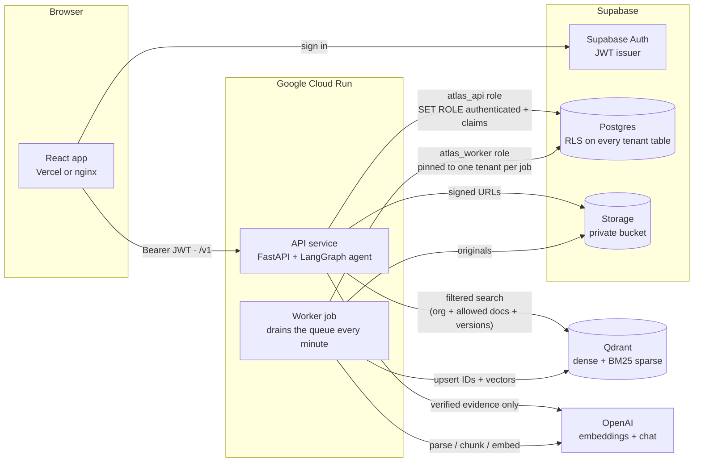

# Architecture

Atlas AI is a modular monolith (ADR 0001): one FastAPI codebase run as an API
service and an ingestion worker, with Postgres (Supabase) as the security
authority and Qdrant as a search index only.

## Request path (chat)

1. **Authenticate**: verify the Supabase JWT (signature, issuer, audience,
   expiry, `role=authenticated`) and an active membership for the org in the URL.
2. **Limits**: per-user rate limit and plan quota (Postgres).
3. **Scope**: allowed documents and current versions from Postgres under RLS.
4. **Agent** (LangGraph, bounded): classify → plan → decompose → hybrid search
   (Qdrant, filtered) → **recheck chunk IDs in Postgres** and load text →
   injection filter → rerank → assess (rewrite ≤ 2 or abstain) → detect conflicts
   → compare versions → generate → verify citations (correct or abstain).
5. **Persist**: message, citations, usage event; stream the verified answer.

## Ingestion path

Upload → validate type/size/content → store at `<org>/<doc>/<version>/` →
document, version and job rows in one transaction → worker claims the job
(`SKIP LOCKED`) → parse (pages, headings) → section-aware chunks (512/64) →
dense + BM25 vectors → Qdrant upsert (IDs only) → verify point count → publish
the version atomically. Failures retry with bounded backoff, then fail cleanly.

## Where things run

| Component | Local (docker compose) | Hosted |
|---|---|---|
| Web app | nginx on :8080 | Vercel |
| API | `api` service | Cloud Run service `atlas-api` |
| Worker | `worker` (polls) | Cloud Run job `atlas-worker` (`--drain`, every minute) |
| Migrations | `migrate` (one-shot) | Cloud Run job `atlas-migrate`, run on each deploy |
| Auth | GoTrue container | Supabase Auth |
| Postgres | `supabase/postgres` image | Supabase (via Supavisor pooler) |
| Object storage | local volume + HMAC-signed URLs | Supabase Storage (private bucket) |
| Vector index | Qdrant container | Qdrant Cloud |
| Telemetry | logs only | OTLP endpoint if configured |

Design decisions: [docs/decisions](../decisions/README.md). Security model:
[docs/security](../security/README.md).
